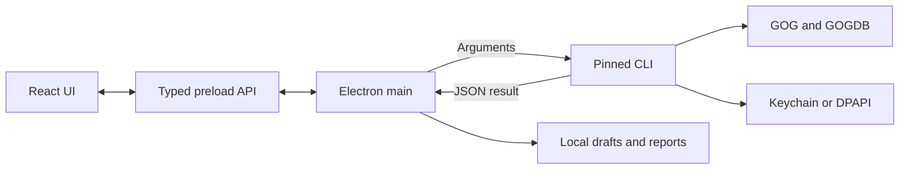

# GOG Achievements desktop app plan

Approved implementation reference, 14 October 2026.

Build a small Electron app that restores GOG achievements the user has already earned. The app provides the screens, local drafts and review flow. The released CLI performs login, GOG requests, queue validation and achievement writes.

The local project is `/Users/beau/Documents/projects/gog-achievements`. The product name is **GOG Achievements**. Bundle CLI **v0.3.0** with each app package, using the verified release assets in [cli-release.lock.json](cli-release.lock.json). The app has its own version and release process.

## First version

Support macOS and Windows, each on ARM64 and x64. Users install the app and use its bundled CLI. The build downloads the pinned CLI release; installation and startup do not download a backend.

Use Electron, React and strict TypeScript. Use electron-vite for development and electron-builder for packages. Pin supported stable tool versions when implementation starts. The selected Electron 44 and CLI v0.3.0 require macOS 13.5 or later and Windows 10/11 on ARM64 or x64. [electron-vite guide](https://electron-vite.org/guide/), [CLI platform support](https://github.com/metacurb/gog-achievements-cli/blob/v0.3.0/README.md).

## User flow

1. **Connect GOG.** Check the bundled CLI and saved login. Sign in through the CLI's native GOG window. Show sign-in, cancellation and credential-store errors clearly. Sign out through the CLI.
2. **Choose a game.** Show owned GOG games, with local search and an explicit Refresh action. Handle an empty library and unavailable game metadata.
3. **Choose achievements.** Show names, descriptions, lock status and unlock dates. Filter by all, locked and unlocked. Give each eligible locked achievement a direct Add to queue action. Preserve existing unlocks. Hide locked hidden-achievement details until the user chooses to reveal them.
4. **Edit the queue.** Group saved drafts by game in one queue that stays visible across game switches and history. Remove individual rows and use a compact per-achievement date dialog to choose a date or use the current time. Save through CLI queue commands and show the returned values. Restore drafts after restart.
5. **Check changes.** A game group's Apply button runs the dry-run check automatically. Then show the game, account and exact requested dates in one final confirmation. Remind the user to close the game before applying.
6. **Apply and review.** Require an explicit final confirmation. Show an active operation while the CLI runs, then show each result and its confirmed date. Refresh achievements after completion. Preserve the report and any items that still need attention.

Use one main window: a game list and search on the left, achievements in the centre, and the account-wide queue beside or below them. Give each game group its own Apply action. Support keyboard navigation and the system light or dark theme. Use placeholders for artwork until trusted image sources are defined.

## Chosen design

**A — Desktop workspace** is the selected design. The [design notes and concepts](docs/design/README.md) retain all three mockups for reference. Each uses sample content and generated artwork.

Use A's three-pane layout: library at left, achievements in the centre, and the queue at right. Use a calendar button on each queued row and a compact date dialog. Keep browsing and the grouped queue together. The later workspace reviews supersede the original bulk date-table concept.

The [screen and interaction design](docs/design/WORKFLOW.md) now covers sign-in, date editing, preview, final confirmation, active apply, complete and partial results, and A's dark appearance. It also defines loading, empty, error and recovery states. Keep existing unlocks read-only and run the dry-run check automatically before final confirmation. The minimum-window and theme checks remain implementation acceptance checks.

## Process boundaries

The main process owns CLI execution, file paths, operation state and final confirmation. The preload exposes named methods such as `listGames`, `setQueueDates` and `applyPreview`. Validate the IPC sender and payloads. Load the local UI with context isolation, sandboxing and Node integration disabled. Render game and achievement text as text, with a restrictive content security policy. [Electron security guidance](https://www.electronjs.org/docs/latest/tutorial/security), [Electron IPC patterns](https://www.electronjs.org/docs/latest/tutorial/ipc).

Launch a fixed executable inside the app resources with `spawn`, argument arrays, `shell: false`, `windowsHide: true` and `--json`. Remove inherited `NODE_OPTIONS` and `NODE_PATH`. The renderer supplies validated IDs and UI choices; main resolves the queue and executable paths. Credentials and login codes remain inside the CLI and its native credential store.

Serialize CLI operations within the app. Use one app instance. Tag requests with an account and game generation so a late result cannot replace a newer screen. Prevent queue edits, sign-out and duplicate apply requests while an apply is active.

## CLI command mapping

Append `--json` to every command. `PATH` is an app-owned path resolved by main. Repeat `--achievement ID` for a batch.

| App action                             | CLI command                                                      |
| -------------------------------------- | ---------------------------------------------------------------- |
| Check version and compatibility        | `--help` and `doctor`                                            |
| Check, create or remove login          | `auth status`, `auth login`, `auth logout`                       |
| Load games                             | `games list`                                                     |
| Load achievements                      | `achievements list --game ID`                                    |
| Create the first draft with selections | `queue create --game ID --file PATH --achievement ID`            |
| Add selections                         | `queue add --file PATH --achievement ID`                         |
| Remove selections                      | `queue remove --file PATH --achievement ID`                      |
| Change one row date                    | `queue set-date --file PATH --achievement ID --unlocked-at DATE` |
| Read the saved draft                   | `queue show --file PATH`                                         |
| Preview                                | `queue apply --file PATH --dry-run`                              |
| Apply the confirmed snapshot           | `queue apply --file PATH --yes`                                  |

Keep every user, game, client and achievement ID as a string. Parse and validate the final JSON even when the child exits with a nonzero code. Success uses `{ok:true,data}`. Failure uses `{ok:false,error:{code,message,details?}}`. Exit codes 2 through 7 distinguish input, authentication, network, conflict, incomplete apply and native failures. Exit 6 includes the apply report in `error.details.report`; keep it available to the UI. [Released command and error contracts](https://github.com/metacurb/gog-achievements-cli/blob/v0.3.0/src/help.mjs), [CLI apply behaviour](https://github.com/metacurb/gog-achievements-cli/blob/v0.3.0/src/service.mjs).

`auth status` checks saved credentials, including their expiry. A later data command can refresh them or require sign-in again. Keep CLI progress messages separate from its JSON result. Bound captured output, allow valid large libraries, and expose validated results and known messages rather than raw process diagnostics.

The app reuses the CLI's saved login. Signing out removes that shared local CLI login; it does not sign out GOG Galaxy.

## Attempt history

Keep a local audit record for each apply: the requested dates, confirmed results and uncertain outcomes. This record supports inspection after failures or interruptions. The UI presents individual confirmed unlocks with their game and date, plus unresolved outcomes, without operation drilldown. It cannot roll back unlocks, relock achievements or change an existing unlock date.

## Drafts and unlock dates

Store drafts under Electron's `userData`, partitioned by account and game. Keep an immutable queue snapshot and an operation record for each apply. Protect local files with platform-appropriate permissions. On logout or account change, clear visible account data and invalidate previews; show retained drafts only for their matching signed-in account.

Let users edit dates only for queued achievements that are still locked. Use the CLI's returned default date when the user supplies no original date. Show the exact value before applying. Display local time with its zone and provide the UTC value for comparison. Send RFC 3339 timestamps with an explicit offset or `Z`, at second precision. Reject invalid calendar dates, nonexistent local times and future dates. Require an explicit offset to resolve an ambiguous local time. Detect the user's time zone and offer all zones supported by the runtime. Reload the actual queue if a save command fails. [CLI date and queue rules](https://github.com/metacurb/gog-achievements-cli/blob/v0.3.0/README.md#create-and-edit-a-queue).

The range of historical dates accepted by GOG still needs live verification. Show requested and confirmed dates separately, preserve date-mismatch reports, and use only a user-authorized restoration for that check.

## Preview and apply state

Bind a successful preview to the exact queue bytes, account and game. Main stores an immutable snapshot, its digest and an opaque preview token. Queue edits, account changes, a restart or a completed attempt invalidate that token. Final confirmation uses the reviewed data from main. Only then may main run `queue apply --yes` on the snapshot. The CLI performs a fresh preflight against GOG before writing.

Present each CLI status without converting partial results to success:

| Status                         | UI meaning                                         |
| ------------------------------ | -------------------------------------------------- |
| `pending`                      | Would be restored in a preview                     |
| `restored`                     | Unlock and requested date confirmed                |
| `skipped_already_unlocked`     | Existing unlock kept                               |
| `restored_with_different_date` | Unlock confirmed with a different date             |
| `failed`                       | Request failed; inspect the reported current state |
| `unconfirmed`                  | The write outcome is uncertain                     |
| `not_attempted`                | This item was not written in this attempt          |

Persist the operation record before starting a write, and save the validated final report atomically. Include requested and confirmed dates in the result view. A crash, missing JSON or transport failure leaves an unknown outcome. On restart, verify the recorded process identity using its PID and start/operation metadata. Keep a surviving child as the active operation and block new CLI operations, including sign-out, until it exits. A new snapshot's lock does not protect against the previous writer. Never kill a process or remove a lock based only on a PID. Then refresh live achievements. A recovery read reports current state; it does not prove which process caused an unlock. Require a fresh preview and explicit confirmation for any further apply. Never replay an apply automatically.

## Long operations and closing the app

CLI v0.3.0 returns a final apply report; it has no streamed apply progress or cooperative apply cancellation. Show an indeterminate active state and keep the window responsive. Prevent a normal quit from interrupting an apply. Handle a forced shutdown through the saved operation record. Electron quit events cannot cover every OS shutdown. [Electron application lifecycle](https://www.electronjs.org/docs/latest/api/app#event-before-quit).

Cancel login by closing the native GOG window. During login, a normal app quit asks the user to finish or close that window first. Do not add a UI Cancel action that merely kills the CLI: Windows process signals terminate it abruptly and do not guarantee native-window cleanup. Portable cancellation would require a separate CLI enhancement. [Node child-process signals](https://nodejs.org/api/child_process.html#subprocesskillsignal).

Use operation-specific limits, including login's configured wait and completion margin. A generic 30-second child timeout is unsuitable for paged libraries or a batch apply. HTTP requests already have CLI deadlines; a hard stop during apply must be treated as an unknown outcome.

## Packaging and releases

Download the exact locked CLI archive during the app build. Verify its SHA-256, safe archive paths and `build.json` version, platform, architecture and layout. Copy the complete extracted folder into `resources/cli` through `extraResources`, outside ASAR. Use the requested package architecture during builds and verify that it matches the running Electron app. Preserve executable permissions. [Builder extra resources](https://www.electron.build/v26/docs/contents/), [Electron archive limitations](https://www.electronjs.org/docs/latest/tutorial/asar-archives).

Intel Mac packages need the launcher, `lib/node`, `lib/main.cjs` and `native/bin/gog-login` in their original relative layout. Build four separate app packages. Use DMG and ZIP for Mac, and NSIS installers for Windows. Windows login still needs Microsoft's WebView2 Runtime; provide its install guidance when the CLI reports it missing. [Released CLI package requirements](https://github.com/metacurb/gog-achievements-cli/blob/v0.3.0/README.md).

Include version, OS and architecture in every artifact name, such as `gog-achievements-desktop-VERSION-windows-arm64.exe`. Each Windows build packages one architecture. Set `nsis.buildUniversalInstaller` to `false` to preserve separate installers. Verify six packages: ARM64 and x64 Mac DMG/ZIP files, plus ARM64 and x64 Windows installers, with a checksum for each. [NSIS artifact options](https://www.electron.build/v26/docs/nsis/).

Prove signing before promising a signed public installer. The current Mac CLI and helper use ad hoc signatures; Windows assets are unsigned. ARM64 Mac embeds the helper inside its executable, so signing the outer CLI does not sign that extracted helper. A signed upstream CLI release may be needed. Intel's private Node runtime also needs suitable signing entitlements. Test a downloaded package on a clean machine. [Electron signing](https://www.electronjs.org/docs/latest/tutorial/code-signing), [Builder Mac signing options](https://www.electron.build/v26/docs/mac/).

After a GitHub repo exists, use Release Please for the app's own version. CI runs lint, formatting, type checks, tests, package builds and smoke checks on all four native targets. Keep a release in draft until the complete installer set and checksums pass. Show app and bundled CLI versions in diagnostics. Update the CLI lock through a reviewed change and rerun contract and package checks.

## Code ownership

| Planned area                    | Responsibility                                                      |
| ------------------------------- | ------------------------------------------------------------------- |
| `src/shared/`                   | IPC schemas, result types and status definitions                    |
| `src/main/cli-client.ts`        | Fixed command construction, process execution and JSON validation   |
| `src/main/operation-manager.ts` | Serialization, preview tokens, confirmation and operation lifecycle |
| `src/main/queue-store.ts`       | Draft paths, snapshots, operation records and reports               |
| `src/preload/`                  | Narrow typed bridge into main                                       |
| `src/renderer/features/`        | Login, games, achievements, queue and result screens                |
| `scripts/`                      | Locked CLI download, package verification and release checks        |

Define command construction, IPC validation and result mapping once. Keep GOG rules in the CLI, process behaviour in main, and presentation in React components.

## Tests and acceptance

- Test command arguments, all error envelopes, exit 6 reports, string IDs, large output, missing binaries and version mismatches with a fake CLI.
- Test IPC validation, account changes, stale results, duplicate clicks, queue locks and rejected stale preview tokens.
- Test date offsets, leap days, daylight-saving changes, future dates and failed date saves.
- Test every report status, an interrupted operation, a surviving child and recovery without an automatic write.
- Test the full UI flow with a fake CLI, including proof that preview never sends `--yes` and that cancelling final confirmation starts no write.
- Smoke-test real packaged apps with the released CLI: version, JSON help, an offline fixture queue and native availability. Cover paths with spaces, a read-only installation folder, a cold helper cache and machines without system Node or .NET.
- Complete human sign-in and read-only library checks on Mac and Windows. Verify WebView2 install guidance and downloaded-package launch behaviour. Automated tests and development checks make no real achievement writes.

## Delivery order

| Milestone              | Reviewable result                                                                                  |
| ---------------------- | -------------------------------------------------------------------------------------------------- |
| 1. Packaged foundation | Electron shell, typed bridge, CLI lock/downloader and packaged CLI smoke proof on all four targets |
| 2. Login and browsing  | Saved login check, native sign-in, library search, achievements and useful empty/error states      |
| 3. Persistent queues   | Direct queue actions, date controls and account-specific draft restoration                         |
| 4. Preview and apply   | Bound previews, final confirmation, complete and partial reports, quit guard and crash recovery    |
| 5. Release readiness   | Native CI, installer and signing proof, versioned releases, checksums and user documentation       |

Resolve public signing credentials before public distribution. The package sets macOS 13.5 as its minimum OS version. A later CLI release can add portable cancellation, progress events or durable write journals if the UI needs them. The first UI version can use v0.3.0 without those additions.
