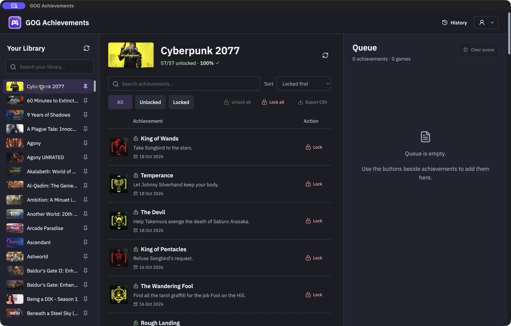

# GOG Achievements

Restore missing GOG achievements you have already earned, on Mac and Windows. Choose an achievement, set its unlock date and review the changes before sending them to GOG.

[Get the app](#download-and-install) · [How to use it](#restore-an-achievement)



_The Mac app with one achievement queued._

## Download and install

Get installers from [GitHub Releases](https://github.com/opista/gog-achievements/releases).

Choose the file whose name ends with the matching text below:

| Your computer                        | Filename ends with  |
| ------------------------------------ | ------------------- |
| Mac with an Apple chip (M1 or later) | `macos-arm64.dmg`   |
| Mac with an Intel processor          | `macos-x64.dmg`     |
| Most Windows PCs (Intel or AMD)      | `windows-x64.exe`   |
| Windows PC with an ARM processor     | `windows-arm64.exe` |

On a Mac, open the `.dmg` file and drag **GOG Achievements** into **Applications**. On Windows, open the `.exe` file and follow the installer.

Requires macOS 13.5 or later, or Windows 10/11. Current builds are unsigned, so macOS or Windows may block the app or show a security warning. Only continue if you trust the download. See [Apple’s instructions for opening an app from an unidentified developer](https://support.apple.com/guide/mac-help/open-a-mac-app-from-an-unidentified-developer-mh40616/mac) or [Microsoft’s SmartScreen guidance](https://support.microsoft.com/en-us/windows/security/windows-security/app-browser-control-in-the-windows-security-app).

## Restore an achievement

1. Open the app and choose **Sign in with GOG**.
2. Choose a game from **Your Library**. You can search for it by name.
3. Select **+** beside a locked achievement to add it to the **Queue**.
4. To set its unlock date, select the calendar button beside the queued achievement, choose the date and time, then select **Save date**. Dates use your computer’s local time.
5. Close the game, then select **Apply changes** in its queue. Check the achievements and dates in the confirmation window, then select **Apply** to confirm.

You can queue achievements from several games and apply one game at a time. Your queue is saved between visits. Use **×** to remove an item before applying.

**Unlocks cannot be undone.** Only add achievements you have already earned. Achievements that are already unlocked keep their existing dates; the app cannot relock them or change those dates. Queue changes stay on your computer until you confirm **Apply**.

## History and updates

Open **History** to see confirmed unlocks and their dates. Any results the app could not confirm are shown separately. Keep the app open while changes are being applied and check the result before trying again.

The app tells you when a newer release is available. You can also open the account menu in the top-right corner and choose **Check for updates…**. Choose **Download** to open the new installer in your browser, then install it yourself. Your saved queue and history stay on your computer.

If sign-in fails on Windows, check that [Microsoft’s WebView2 Runtime](https://developer.microsoft.com/microsoft-edge/webview2/) is installed. Login details stay on your computer, protected by macOS Keychain or Windows encryption.

---

## Developer information

The app uses Electron, React, NestJS and a typed IPC bridge. It bundles [CLI v0.4.0](https://github.com/opista/gog-achievements-cli/releases/tag/v0.4.0), which handles GOG login and achievement requests. Installed packages include the CLI; they do not download it at startup.

### Run from source

Use Node 24.19.0, recorded in [.node-version](.node-version).

```sh
npm ci
npm run cli:download
npm run dev
```

Source builds download the pinned public CLI release and verify its checksum. If the CLI repository is private, use `GH_TOKEN`, `GITHUB_TOKEN`, or an existing `gh` login with read access. Installed app packages already contain the verified CLI and do not download it at startup.

To test an unreleased CLI fix locally, set `GOG_ACHIEVEMENTS_DEV_CLI_DIRECTORY` to the absolute build directory that contains `build.json` and the executable, then run `npm run dev`. The build must match the pinned CLI version, platform and architecture. Installed apps ignore this development setting and use their bundled release. This does not change the release lock or downloaded CLI files.

If a new Mac helper cannot read the saved login, choose **Sign in with GOG** and allow Keychain access locally when asked. Windows uses DPAPI for credential storage. Native prerequisites are reported by the CLI.

### Browser preview

```sh
npm run dev:web
```

Open [the demo](http://localhost:5173/?demo=1). It uses sample data and simulated results. It never invokes the real CLI. Choose complete, partial, uncertain, empty or read-error scenarios in its header. For visual checks, add `&theme=light` or `&theme=dark`. Desktop appearance follows the system theme.

A browser without `?demo=1` shows that the desktop bridge is unavailable.

### Tests and packaging

```sh
npm run check
npm run test:e2e
npm run build -- --target=macos-arm64
npm run test:desktop
npm run package -- --target=macos-arm64
```

Targets: `macos-arm64`, `macos-x64`, `windows-arm64`, `windows-x64`. Run each target on a matching native host. Build compiles the app; package also produces Mac DMG/ZIP files or a Windows installer and SHA-256 files.

```sh
npm run cli:smoke -- --target=macos-arm64
node scripts/verify-package.mjs --target=macos-arm64 --directory 'dist/mac-arm64/GOG Achievements.app'
```

Tests use fake CLI responses and sample accounts. Browser tests run the demo flow on a separate temporary server. Offline smoke checks read help and a fixture queue. Neither makes achievement writes.

The desktop test launches the compiled app in demo mode and checks the real renderer → sandboxed preload → IPC bridge → Nest service flow. After packaging, set `GOG_DESKTOP_PACKAGE_DIRECTORY` to the unpacked app directory to run the same check against that package. The test uses sample data and makes no GOG writes.

Packages are currently unsigned. Developer ID signing, notarization and Windows signing remain distribution tasks. Native login and installation still need checks on each supported platform.

Development runs use the stock Electron executable, so the Mac Dock can show **Electron** and its icon. The packaged `.app` uses the GOG Achievements name and icon. Update checks require a packaged app (`app.isPackaged`); compiling with `npm run build` alone does not enable them. You can run the generated `.app` directly from `dist`.

The supported OS versions combine the [bundled CLI runtime](https://github.com/opista/gog-achievements-cli/blob/v0.4.0/README.md) and [Electron 44](https://releases.electronjs.org/release/v44.0.0). Dates are displayed and edited in local time; stored timestamps retain their UTC instants. Durable operation records support recovery and the history view.

### CI and source layout

[CI](.github/workflows/ci.yml) checks formatting, lint, types, unit tests and the offline demo, then packages all four native targets. Fork pull requests run offline checks without repository secrets. Manual CI runs can select one target.

Release Please maintains a version pull request from conventional commits on `main`. Merging that pull request creates a draft release, runs the checks and native builds, verifies all packages and checksums, then publishes the release. Read the [release guide](docs/RELEASING.md) for setup and retries.

Installed apps check for a newer public stable release once at startup. The native menu also offers **GOG Achievements → Check for Updates…** on macOS, or **Help → Check for Updates…** on Windows. Notices wait until active CLI work finishes. Update checks need no GOG or GitHub login.

| Area            | Responsibility                                                           |
| --------------- | ------------------------------------------------------------------------ |
| `src/shared/`   | CLI data contracts, IPC validation and shared demo backend               |
| `src/main/`     | Nest providers, IPC controllers, fixed CLI commands, drafts and recovery |
| `src/preload/`  | Generated IPC bridge setup, readiness and operation event subscription   |
| `src/renderer/` | Transport adapter, workspace, dates, review and report screens           |
| `scripts/`      | Verified CLI download, native packaging, checksums and offline smoke     |
| `tests/`        | Backend, renderer, date and archive/packaging behaviour                  |

Read the [plan](PLAN.md), [screen design](docs/design/WORKFLOW.md), [implementation notes](docs/IMPLEMENTATION.md) and [CLI release lock](cli-release.lock.json).

IPC method types are generated from the main-process controller by `@electron-ipc-bridge/vite-plugin`. `npm run dev`, desktop builds and `npm run typecheck` generate them automatically. Run `npm run ipc:generate` to refresh editor types directly. Generated files are ignored by Git and need no manual edits.
