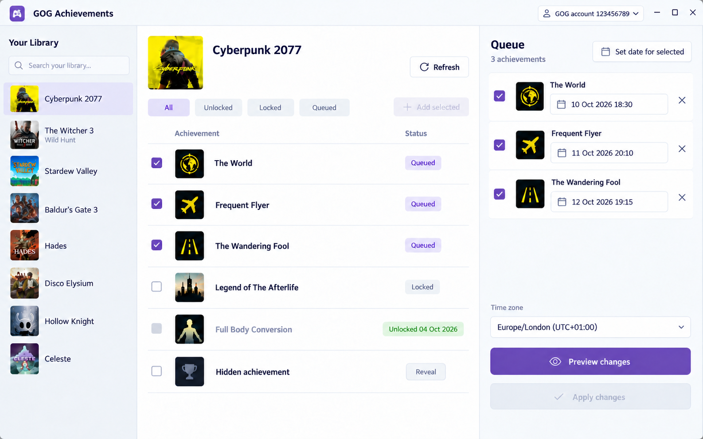
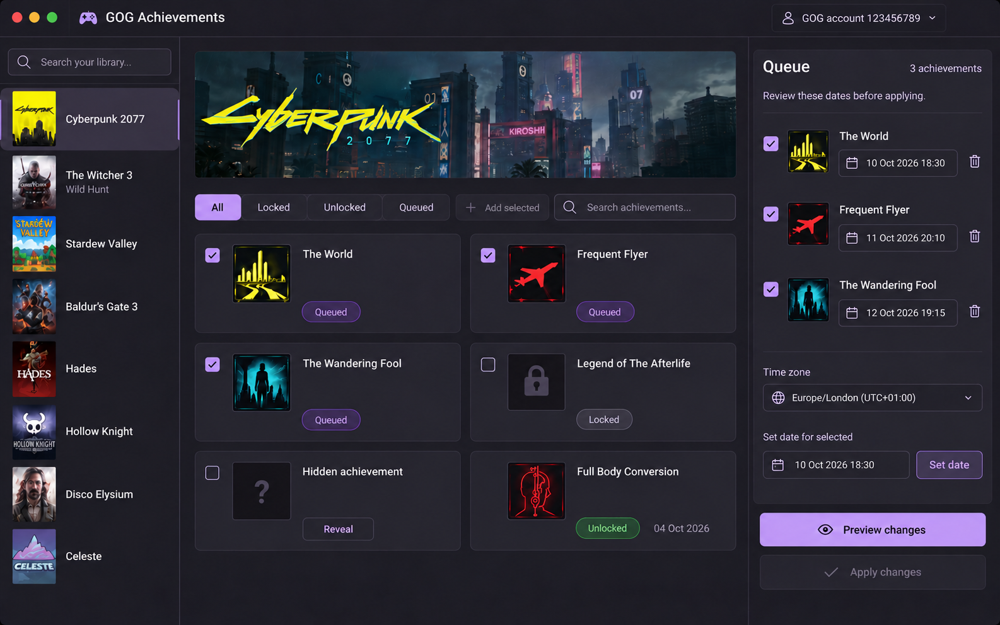
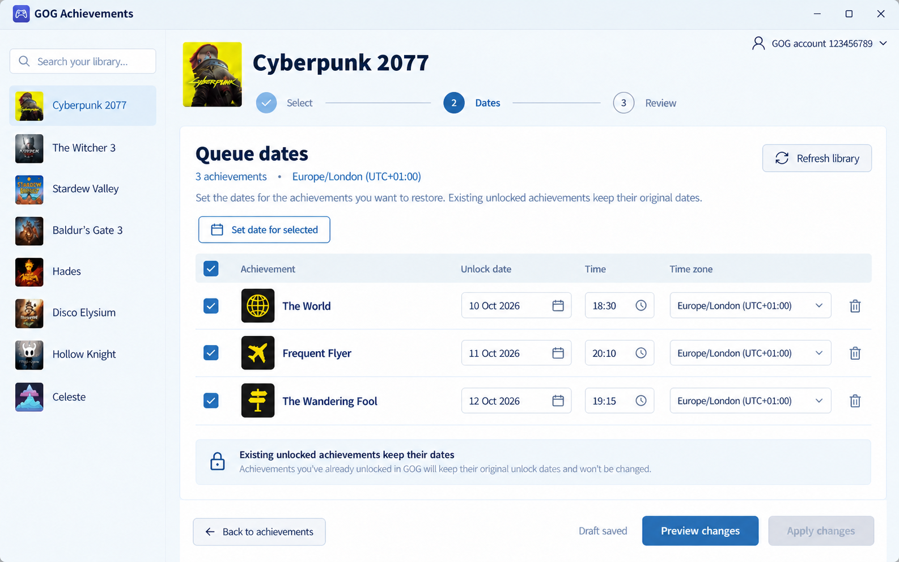

# GOG Achievements design candidates

Design direction selected on 14 October 2026: **A — Desktop workspace**. The three concepts remain below for reference.

All three images use sample account details, games, achievements and dates. Artwork is generated for the concepts. The sample library does not state game availability or ownership. These images show layout ideas, not live account data.

**Chosen direction: A's desktop workspace, with C's detailed date editor.** Keep A's simultaneous panes and use C's date-table controls within the date editor. This keeps browsing and the queue together while giving bulk date changes enough space.

| Candidate             | Approach                                        | Strength                                     | Tradeoff                                     |
| --------------------- | ----------------------------------------------- | -------------------------------------------- | -------------------------------------------- |
| A — Desktop workspace | Light, three-pane utility                       | Library, achievements and queue stay visible | Less room for complex date details           |
| B — Game library      | Dark, artwork-led library                       | Clear game identity and a persistent queue   | Fewer achievements fit on screen             |
| C — Review ledger     | Wide table with Select, Dates and Review stages | Precise bulk date editing                    | More navigation between browsing and editing |

## A — Desktop workspace

A compact utility with a clear list, restrained plum accents and direct actions. Keep the three panes resizable. Use a date detail panel when the queue needs more space.

Starting palette: white canvas, `#F2F4F8` library, `#1D2635` text, `#7150A2` accent. Typography direction: IBM Plex Sans, with tabular date numerals. These are proposed tokens, not exact measurements from the image.

## B — Game library

Use one game banner and flat achievement tiles. The queue remains visible at the right. Keep artwork secondary to names, status and dates.

Starting palette: `#211F2A` background, `#2D2938` surfaces, `#F4F1F7` text, `#BBA4E6` accent. Typography direction: a humanist sans with a compact game title. This approach needs more vertical scrolling and a defined source for production artwork.

## C — Review ledger

Give queue dates a full-width table and keep the next action clear. Use this table's controls within A's date editor. Default to one display time zone; show an explicit offset in date details when needed.

Starting palette: `#F4F7FB` canvas, white work area, `#172C43` text, `#346A9D` accent. Typography direction: Source Sans 3 with tabular date numerals. C's full staged layout remains an alternative concept; the selected app uses A's simultaneous panes.

## Rules shared by all candidates

- Keep achievement selection and queue-row selection separate. Queue checkboxes select rows for bulk date changes. A queued badge shows membership; it does not mean an item is unlocked.
- Keep existing unlocks and their dates read-only. Show descriptions in row details. Keep hidden achievement details concealed until Reveal.
- Show saved draft state only after a CLI command succeeds. Keep the account and game visible during review.
- Enable Apply only after a successful preview of the current queue. Explain the disabled state with “Preview changes to enable Apply”. Require final confirmation.
- Show exact timestamps, including seconds, zone and UTC value, in date details and preview. The concepts shorten the visible dates for space.
- Use an indeterminate state during apply. Show requested and confirmed dates and each result status. Preserve partial and uncertain results.
- Support keyboard focus, labelled controls, status text and system light/dark themes. Use the correct native window controls on Mac and Windows. A candidate's pictured chrome or theme does not limit platform support.

## Refined screens

The [desktop workflow](WORKFLOW.md) adds eight screen concepts: sign-in, queue dates, preview, final confirmation, applying, complete results, results needing attention, and A's dark appearance. It defines the actions, copy, loading/empty/error variants, recovery rules and layout targets. All images use sample content.

Check the implemented layout at the proposed minimum window size of 1120 × 720 and in both themes. The concepts are design references.

The [main plan](../../PLAN.md) remains the source for CLI behaviour, process boundaries and acceptance checks. The concepts do not add new CLI capabilities.

## Generation record

Generated and edited with the built-in ImageGen tool. [prompts.json](prompts.json) contains the exact generation and revision prompts for each saved PNG. The source tool outputs were retained.
