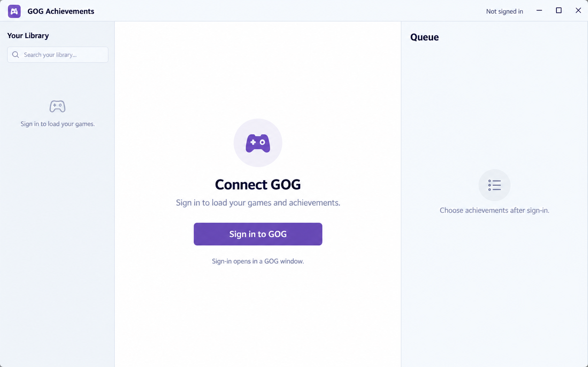
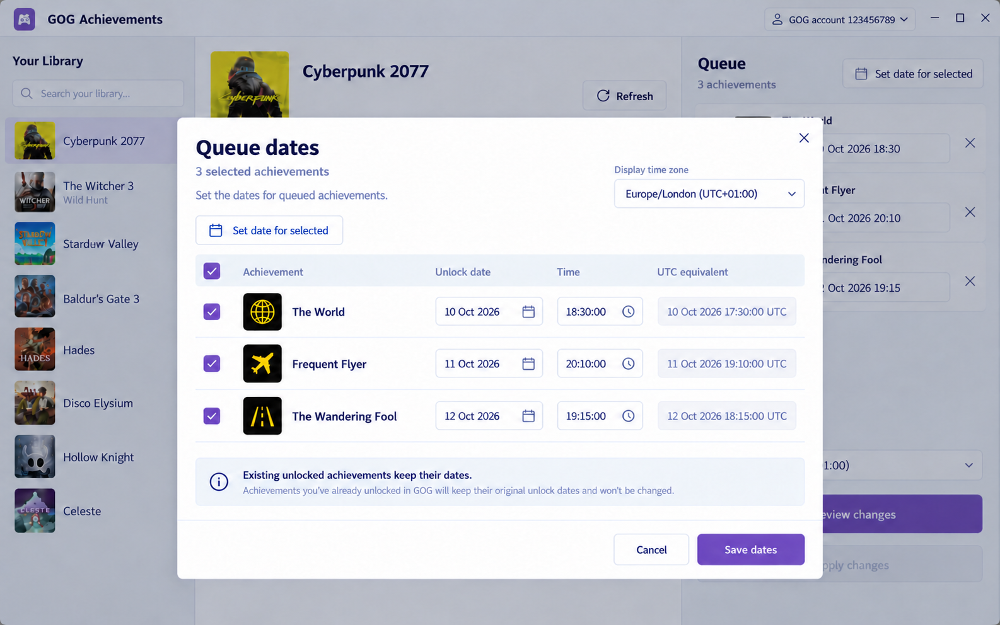
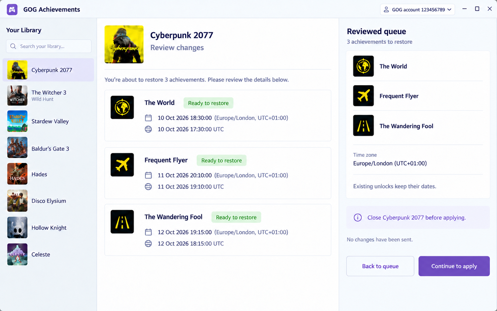
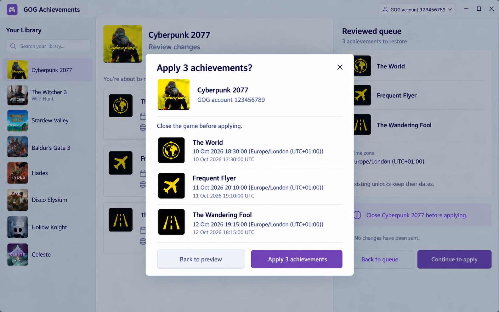
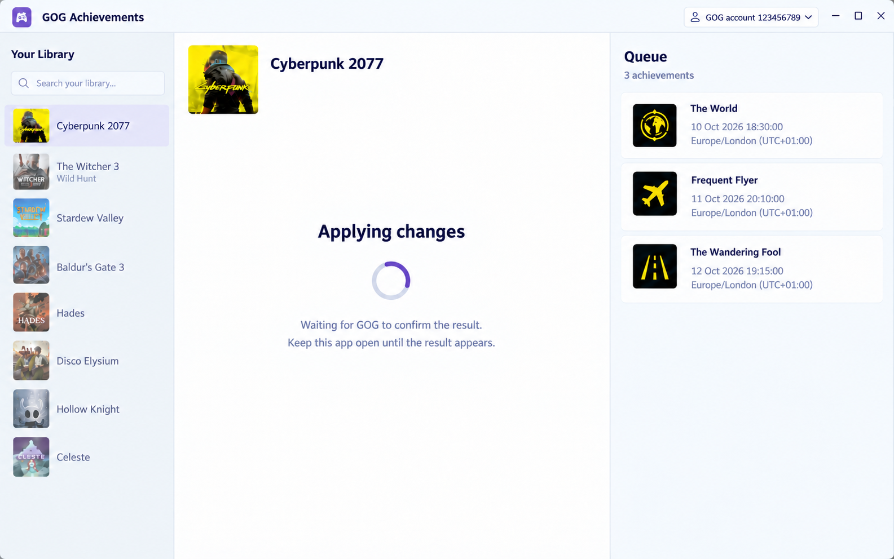
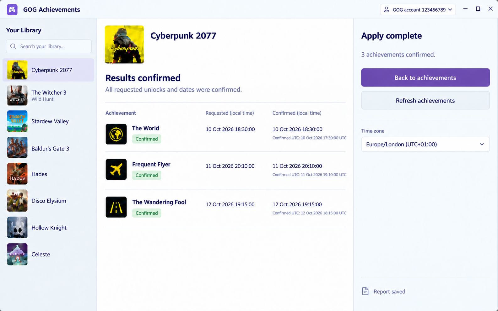
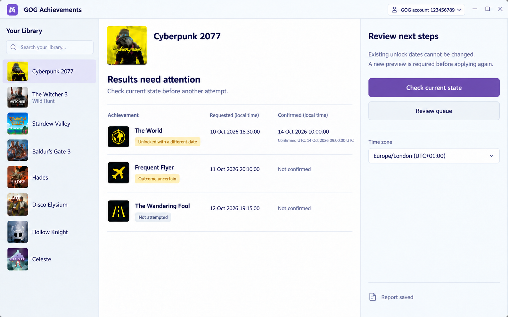
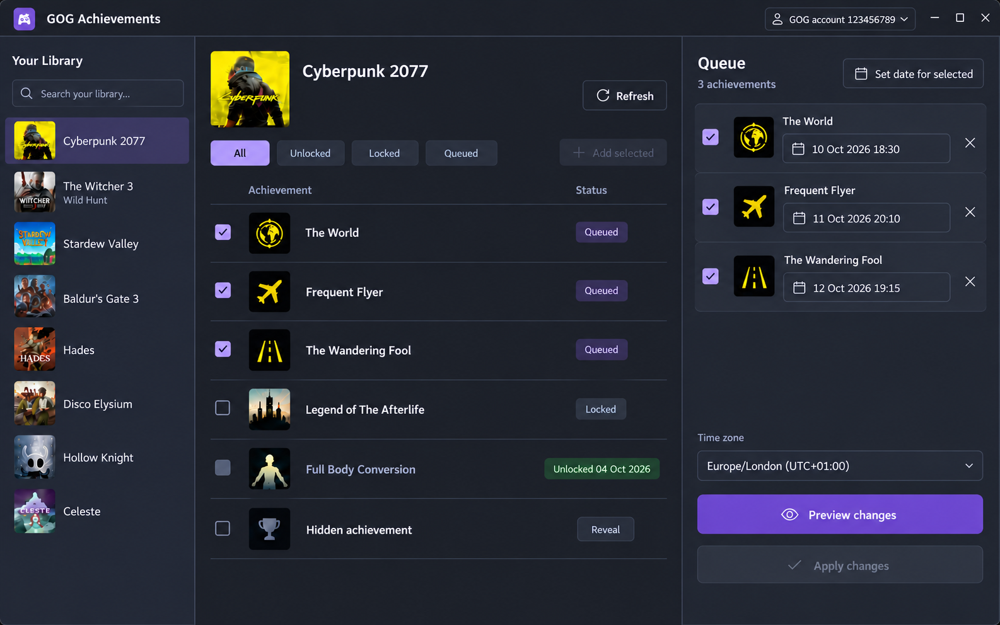

# GOG Achievements desktop workflow

Design pass, 14 October 2026, following the chosen **A — Desktop workspace**. All images and examples use sample data and generated artwork. These are design references for implementation.

## Mixed actions update, 15 October 2026

This update takes precedence over the restoration-only concepts below. Use the approved **Quiet actions** design and keep the current three panes and one confirmation per game. Keep achievement names and descriptions visible. Show the current **Locked** or **Unlocked** state as muted text beneath the description, including the existing unlock date when available. Show one neutral **Unlock** or **Re-lock** action, with an open or closed padlock. A queued row replaces that action with **Queued** and a check mark; clicking it removes the saved request. Its accessible name identifies the saved action even if the live state has changed.

Within each game, group queued requests under **Unlock** and **Re-lock** headings with counts. Show the action once per group, with a plum icon and plain text. Keep names and descriptions in plain rows without repeated coloured badges, cards or artwork. Retain each unlock's date editor, since requested dates can differ. Re-lock requests retain their previous dates for the review and history and have no date editor. **×** only removes the queued request.

**Review changes** checks all requests, then shows their actions and exact dates in one dialog. The final button states the pending counts: **Unlock 2 achievements**, **Re-lock 2 achievements**, or **Unlock 2 achievements and re-lock 2 achievements**. Use the same quiet action labels in confirmation, results and history. Cancel sends no writes. Keep Cancel as the initial focus.

Results distinguish confirmed **Locked**, **Already locked**, and uncertain outcomes. A missing date alone must not show a successful lock. Only confirmed matching requests leave the queue. **Achievement history** retains previous unlock dates for confirmed locks and keeps failed, uncertain and unattempted actions under **Needs attention**. Unlocking again is a new reviewed request; history provides no automatic undo.

| Screen                                               | Main action                     |
| ---------------------------------------------------- | ------------------------------- |
| [Connect GOG](states/sign-in.png)                    | Sign in to GOG                  |
| [Queue dates](states/queue-dates.png)                | Save dates                      |
| [Review changes](states/preview.png)                 | Continue to apply               |
| [Final confirmation](states/confirmation.png)        | Apply the reviewed achievements |
| [Applying](states/applying.png)                      | Wait for the result             |
| [Results confirmed](states/complete-results.png)     | Back to achievements            |
| [Results need attention](states/partial-results.png) | Check current state             |
| [Dark workspace](states/desktop-workspace-dark.png)  | Same controls as A              |

The [main plan](../../PLAN.md) defines the CLI and process contract. [Generation prompts](states/prompts.json) record the exact briefs and edits.

## Workspace and access

Keep A's three panes: library at left, achievements in the centre, queue at right. Use C's date-table controls inside A's date editor; retain A's workspace navigation. The **proposed minimum window is 1120 × 720 CSS pixels**. Verify this size during implementation. Let the panes resize and scroll independently; keep queue actions visible. Long names wrap or expand into details.

Design every state in system light and dark themes. Use a restrained plum accent, readable text, visible keyboard focus and labelled controls. Status uses text as well as colour. Tab order follows library → achievements → queue → actions. Space toggles a focused checkbox. Dialogs contain focus, Escape closes them when safe, and closing restores focus to the invoking control. Announce loading, save results and errors without moving focus.

## Sign-in, loading, empty and error states

| State                           | Content and action                                                                                                                                                                                                         |
| ------------------------------- | -------------------------------------------------------------------------------------------------------------------------------------------------------------------------------------------------------------------------- |
| Startup                         | Show “Checking GOG sign-in…” while checking the bundled CLI and saved login. Disable account-dependent actions.                                                                                                            |
| Signed out                      | Keep the workspace frame; show “Connect GOG” with **Sign in to GOG**. Do not show retained account data.                                                                                                                   |
| Signing in                      | Show “Complete sign-in in the GOG window.” Use an indeterminate indicator. Disable duplicate sign-in. The user cancels by closing the native GOG window. A normal app quit asks them to finish or close that window first. |
| Sign-in cancelled or failed     | Return to a usable signed-out view with a clear message and **Sign in to GOG**. Credential-store and missing WebView2 errors give the relevant next step.                                                                  |
| Loading library or achievements | Show a loading state in the affected pane. Keep matching saved drafts visible; do not mistake missing results for an empty library.                                                                                        |
| Empty library                   | Show “No GOG games found” and **Refresh library**. A search with no matches offers **Clear search**.                                                                                                                       |
| No achievements                 | Show “No achievements available for this game.” An empty filter offers **Clear filters**.                                                                                                                                  |
| Read error                      | Keep available matching data labelled as not refreshed. Show the failed action and **Retry**. Authentication errors offer sign-in again.                                                                                   |

On account change, clear visible account data and invalidate previews. Restore drafts only for their matching account and game.

## Queue and date editing

Achievement checkboxes select additions. Queue checkboxes separately select rows for bulk date edits. A **Queued** badge denotes queue membership. Existing unlocks and their dates remain read-only. Show descriptions in row details; reveal concealed achievement details only on request.

An empty queue says “Select achievements you have already earned.” Disable Preview and Apply. Adding or removing rows saves through the CLI; display **Draft saved** only after success. Failed mutations show an error and reload the actual queue. Keep unrelated selections intact where valid.

Open **Edit date** for one row or **Set date for selected** for multiple queue rows. The editor has achievement selection, date, time including seconds, and a display zone. Default to one zone. Show both the exact local timestamp and UTC value before saving. Example:

- Local: **10 Oct 2026, 18:30:00 — Europe/London (UTC+01:00)**.
- Sent value: `2026-10-10T18:30:00+01:00`.
- UTC: `2026-10-10T17:30:00Z`.

Use the CLI's returned default when no original date is supplied. Reject invalid dates, future dates and nonexistent local times. An ambiguous time requires an explicit offset. Do not claim GOG accepts all historical dates. A bulk save applies the chosen timestamp to selected rows; reload the actual queue if any command fails. Label the read-only conversion column **UTC equivalent**. The footer actions are **Cancel** and **Save dates**. Closing the editor before saving discards only its unsaved UI edits. The bulk control opens common date/time fields for selected rows; it changes unsaved editor values. Save groups commands by timestamp and displays the CLI-returned queue.

## Preview and final confirmation

**Preview changes** performs a read-only check. Show account, game, requested timestamps and separate lists for achievements to restore and existing unlocks to skip. Include the reminder **Close the game before applying**. If nothing needs restoration, show that state and keep Apply disabled.

Apply is disabled before a successful preview: “Preview changes to enable Apply.” Queue changes, account/game changes, restart or a completed attempt invalidate the preview. Show **Queue changed — preview again** when applicable. The reviewed snapshot and preview token belong to main; the renderer cannot substitute edited data.

After preview, use **Continue to apply** to open final confirmation with the same account, game, restoration count and exact dates. Offer **Back to preview** and **Apply N achievements**, where N is the number to restore. Dismissing the confirmation performs no write. Focus Back to preview first; do not let a generic Enter key start the write. After confirmation, disable duplicate requests immediately.

## Applying and quit guard

Show **Applying changes…** with an indeterminate indicator. Keep the window responsive, but disable queue edits, game/account changes, refresh and sign-out while the serialized write is active. Do not show percentage progress or a Cancel action: CLI v0.3.0 supports neither for apply.

Persist an operation record before writing. Prevent a normal quit from interrupting the operation; show **Changes are still being applied. Keep the app open until the result is available.** A forced shutdown follows the recovery rules below.

## Results and recovery

Show a persistent report with each achievement, requested date, confirmed date when known, and the CLI status. Keep the account and game visible. Refresh achievements after completion; a refresh failure does not erase the report.

| Result                                  | Presentation and next action                                                                                                                                                                                                                                                                                                                 |
| --------------------------------------- | -------------------------------------------------------------------------------------------------------------------------------------------------------------------------------------------------------------------------------------------------------------------------------------------------------------------------------------------- |
| Complete                                | Show **Results confirmed** when all outcomes are confirmed restorations or existing unlocks kept. Preserve the report. Offer **Back to achievements** and **Refresh achievements**.                                                                                                                                                          |
| Partial                                 | Show **Results need attention**. Distinguish restored, skipped, restored with a different date, failed, unconfirmed and not attempted. Keep items needing attention available in a draft.                                                                                                                                                    |
| Missing report or interrupted operation | Show **Outcome unknown**. Do not call it success or failure, and do not replay Apply automatically.                                                                                                                                                                                                                                          |
| Recovery                                | Verify recorded process identity using PID and start/operation metadata. If a writer survives, show it as active and block new CLI operations until it exits. Never kill a process or remove a lock based only on PID. Then refresh live achievements and label that result as current state, not proof of which operation caused an unlock. |

Offer **Check current state** for a read-only refresh and **Review queue** to inspect the retained draft. Refresh failures preserve the report. Another write requires a fresh preview and explicit confirmation; never offer an automatic retry, Undo or Fix date for an existing unlock.

Use these labels consistently:

| CLI status                     | Row label                                      |
| ------------------------------ | ---------------------------------------------- |
| `pending`                      | Ready to restore; preview only                 |
| `restored`                     | Confirmed                                      |
| `skipped_already_unlocked`     | Already unlocked                               |
| `restored_with_different_date` | Unlocked with a different date                 |
| `failed`                       | Request failed; include the actual known cause |
| `unconfirmed`                  | Outcome uncertain                              |
| `not_attempted`                | Not attempted                                  |

Do not infer that a failed request was rejected by GOG or that an uncertain result is locked. A date mismatch confirms the unlock with a different date; the released CLI cannot change an existing unlock's date.

## Visual inventory and layout targets

Use the selected A screenshot as the layout reference. Keep the type, control sizes, pane boundaries and artwork scale consistent across states.

| Element      | Design target                                                                                                           |
| ------------ | ----------------------------------------------------------------------------------------------------------------------- |
| Type         | IBM Plex Sans direction, 16px body, 14px labels, 24px section headings, tabular date numerals                           |
| Spacing      | 8px base unit, 24px pane padding, 6px control radius, thin separators                                                   |
| Panes        | Library 216–280px; queue 336–400px; central area uses the remaining width                                               |
| Dialogs      | Date editor up to 1160px; confirmation up to 720px; keep 32px window margins where space permits                        |
| Small window | At 1120 × 720, scroll pane and dialog bodies; keep dialog footer actions visible                                        |
| Icons        | Consistent outline search, refresh, calendar, clock, account, remove and reveal icons; visible text or accessible names |
| Artwork      | Small game covers and achievement thumbnails; generated art is reference material                                       |

Dialog widths and pane ranges are targets, not measurements verified in a running app. Check long names, exact timestamps, focus visibility and both themes at the minimum window size during implementation. Keep low-density sign-in and waiting states inside the same shell.

### Dark appearance

Retain A's layout and controls. The dark reference uses a neutral charcoal canvas, off-white text and a pale plum accent. It adds no game banner or staged navigation.

Starting tokens remain subject to rendered contrast checks:

| Role          | Light     | Dark      |
| ------------- | --------- | --------- |
| Canvas        | `#FFFFFF` | `#1D2028` |
| Library       | `#F2F4F8` | `#232734` |
| Queue surface | `#FFFFFF` | `#292E3C` |
| Main text     | `#1D2635` | `#F2F3F8` |
| Muted text    | `#617087` | `#A9B2C5` |
| Divider       | `#E0E5ED` | `#414A5D` |
| Accent        | `#7150A2` | `#B39CE6` |

Use colour with status text. Preserve visible focus, selected, hover, read-only and disabled states. Respect reduced motion; the active-operation message must stay clear without spinner motion.

## Implementation review checks

- Sign-in and data reads show the correct loading, empty, cancelled and error states.
- Saving dates does not apply achievements, and failed saves reload the queue.
- Preview sends no write. Editing or changing account/game invalidates it.
- Final confirmation displays the exact reviewed account, game and timestamps.
- Active apply disables edits and other CLI operations and permits no normal quit.
- Complete, partial and unknown outcomes preserve reports and never trigger a write automatically.
- Dark/light theme, keyboard navigation, dialog focus and 1120 × 720 layout work in the running app.
